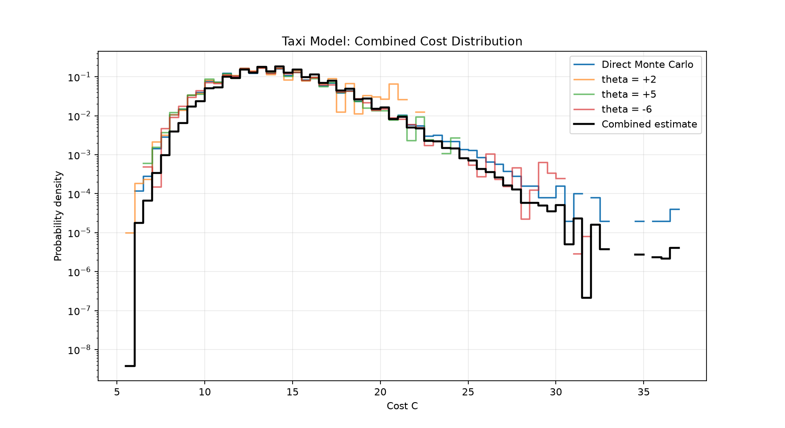
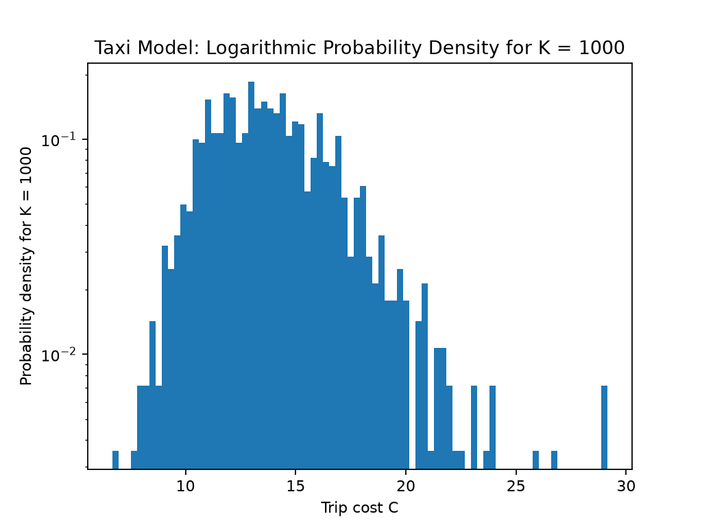

# Taxi Model Rare Events

A computational-physics project on rare-event sampling in a stochastic taxi model. This repository combines the original C/Python research code with a reviewed scientific implementation for the *historical full-crossing model*. The bachelor-thesis study is ongoing at the University of Oldenburg.

> **Model convention and research status.** The completed historical 52-job campaign used a full-crossing terminal-cost convention: the final exponential ride contributes its entire sampled length, including the overshoot beyond the destination. Prof. Alexander Hartmann's proposed thesis model charges only the actual remaining distance on the final ride. That is a different terminal-cost rule. The thesis model, its new biased-MCMC study, conditional distributions, and large-deviation analysis are **work in progress**; the archived figures and earlier campaign do not validate those new objectives.

## Research motivation

Rare, high-cost trips are poorly sampled by direct Monte Carlo. Biased sampling can improve coverage, after which reweighting combines observations from multiple bias windows. The ongoing thesis asks how total cost and ride count fluctuate jointly, how observables depend on cost, and how those distributions change as the destination length grows.

The research direction is to investigate the joint statistics of total taxi cost `C` and number of rides `N` using biased MCMC; reconstruct rare-event distributions through multi-histogram reweighting; study `P(N | C)` and, more generally, `P(O | C)`; and examine large-deviation behavior with increasing destination length `L`. Additional observables of interest are the number of long rides and the maximum ride length.

For finite-size analysis, the planned rate-function convention is

\[
  \phi_L(c)=-\frac{1}{L}\log P_L(C),\qquad c=C/L.
\]

The meaning of `P_L(C)` must be specified carefully: the model can have discrete probability atoms as well as continuous contributions. Atom probabilities and continuous densities (or finite-bin probabilities with stated widths) will be analyzed separately. Scaling by `L^alpha` is a question to investigate, not an established result.

## Model definition

Let independent attempted ride lengths be exponentially distributed,

\[
  \eta_i\sim\operatorname{Exp}(\lambda),\qquad X_n=\sum_{i=1}^{n}\eta_i,
\]

with destination length `L` and tariff parameters `eta_c` and `b`. The per-ride tariff for a ride of length `x` is

\[
  q(x)=1+b\max(x-\eta_c,0).
\]

The ride count is the first crossing index `N=min{n:X_n >= L}`. In the **historical full-crossing convention**, `C=sum(i=1..N) q(eta_i)`: the entire terminal ride is charged. In the proposed **thesis convention**, the final ride is truncated to the remaining distance `r=L-X_(N-1)`, so its terminal contribution is `q(r)`; earlier rides retain their sampled lengths. This difference can change the cost law and must be reflected in sampling, acceptance probabilities, reweighting, and analysis before thesis results are reported.

The number of physical rides `N` is distinct from the number of MCMC proposal iterations. Existing full-crossing model code and C samplers in this repository implement the historical convention. They must not be interpreted as an implementation of the proposed truncated-terminal-ride model.

## Methods in the repository

- **Direct Monte Carlo:** the original C simulator draws exponential ride lengths and accumulates trips to the threshold.
- **Biased MCMC:** original C chain programs and a separate reviewed C engine provide historical full-crossing reference implementations. They do not implement the thesis proposal based on a fixed vector of uniform random numbers with randomly modified coordinates.
- **Conditional calculations:** the validated package includes conditional last-step/tail calculations for the historical model. It does not yet estimate the thesis observables `P(O | C)`.
- **Reweighting:** legacy Python scripts combine biased histograms; `experiments/validated/mbar.py` implements a binless MBAR-style multi-window estimator with common-support and overlap checks. A Ferrenberg–Swendsen histogram-gluing comparison remains planned.

## Implemented work and work in progress

### Available in this snapshot

- Original C direct-sampling and MCMC sources, retained in their existing paths.
- A reviewed full-crossing C model/engine and Python analysis components, including MBAR-style reweighting, structural-atom handling, chain diagnostics, and resampling utilities.
- Bounded scientific tests and an exact rational fixture for estimator regression checks.
- Historical summary rows and two archived figures selected from stored research outputs.

The earlier full-crossing campaign comprised a combined 52-job set and is treated here as historical validated work. The displayed material is preliminary: tail uncertainty, correlations, window overlap, and normalization uncertainty limit the precision that can be claimed. The selected figures are archived outputs from stored results; raw traces are not distributed in this portfolio snapshot, so the plots cannot be regenerated from this checkout alone. Historical per-run source configurations are incomplete.

### Thesis work in progress

- Implement and validate the partial-distance terminal ride convention proposed for the thesis.
- Build the fixed-uniform-vector MCMC sampler, including proposal and Metropolis rules appropriate to that state representation.
- Estimate joint and conditional distributions, including `P(N | C)` and `P(O | C)` for additional observables.
- Compare Ferrenberg–Swendsen histogram gluing with the existing MBAR-style approach.
- Study finite-size rate functions, discrete atoms versus continuous densities, and possible `L^alpha` scaling.

No result in the historical campaign establishes these thesis outcomes.

## Selected historical figures

The figures below are portable copies of stored outputs from the earlier full-crossing research. They are illustrative preliminary results, not plots of the new thesis model.

### Historical multi-window cost reconstruction



The combined estimate uses the earlier direct and biased windows. Sparse tails and unpropagated correlation/normalizer uncertainty mean the far-tail curve should not be read as a precision claim.

### Direct Monte Carlo on a logarithmic scale



This is a stored 1,000-trip direct-sampling figure, useful for illustrating why rare tails motivate biasing. Its source CSV is intentionally excluded.

## Preliminary observations

The archived display shows the biased windows extending into cost regions where the direct-sampling histogram becomes sparse. This is a qualitative observation about the historical full-crossing results. It is not a calibrated estimate of tail error, convergence, or the proposed thesis-model distribution. Chain autocorrelation and uncertainty in window normalization can reduce the effective information below the raw number of recorded proposals.

## Repository map

```text
c/                         Original direct-MC and MCMC C sources
experiments/validated/      Reviewed full-crossing model, engine, MBAR and analysis
python/                     Original analysis and plotting scripts
img/                        Two selected historical figures
reproducibility/runs.csv    Historical user-recorded run summary
requirements-analysis*.txt Python analysis environment pins
tests/validated/            Focused scientific tests and exact estimator fixture
```

## Dependencies and Linux setup

The scientific C core uses C11 and the standard math library (`-lm`). Python tests and analysis use NumPy; archived plotting scripts also use Matplotlib. The included pins were read from the existing isolated research analysis environment. They document that environment and are not claims about dependencies used for every historical run.

On Ubuntu or WSL Ubuntu:

```bash
sudo apt update
sudo apt install build-essential python3 python3-venv git
python3 -m venv .venv
source .venv/bin/activate
python -m pip install -r requirements-analysis.lock.txt
```

Use Python 3.11 or newer. No university server, privileged research infrastructure, or production launch script is needed for the focused tests below. Full historical production campaigns are not a reasonable laptop reproduction target, and their raw inputs are not included.

## Lightweight verification

From the repository root, run the deterministic/unit-level scientific suite:

```bash
source .venv/bin/activate
PYTHONPATH=. python -m unittest discover -s tests/validated -p 'test_*.py' -v
```

This builds a small local C test target and checks model/conditional formulas, MBAR and reconstruction behavior against exact or controlled fixtures. It is not a new simulation campaign and does not verify the thesis model. The historical plotting scripts expect their original CSV inputs, which are not part of this public snapshot.

## Research roadmap

1. Specify and independently test the truncated final-ride cost convention.
2. Derive and implement the fixed-uniform-vector proposal and acceptance rule; validate detailed balance on finite fixtures.
3. Run bounded, documented pilot chains and assess mixing, autocorrelation, and support overlap.
4. Compare Ferrenberg–Swendsen gluing against MBAR-style reconstruction with uncertainty estimates.
5. Estimate joint and conditional observable distributions, retaining ride-count and atom structure.
6. Analyze `phi_L(c)` across destination lengths and test, rather than assume, candidate scaling exponents.

## References and acknowledgement

- A. M. Ferrenberg and R. H. Swendsen, “Optimized Monte Carlo data analysis,” *Physical Review Letters* **63**, 1195 (1989), [doi:10.1103/PhysRevLett.63.1195](https://doi.org/10.1103/PhysRevLett.63.1195).
- M. R. Shirts and J. D. Chodera, “Statistically optimal analysis of samples from multiple equilibrium states,” *Journal of Chemical Physics* **129**, 124105 (2008), [doi:10.1063/1.2978177](https://doi.org/10.1063/1.2978177).

This is ongoing bachelor-level computational-physics research at the University of Oldenburg. The proposed truncated-terminal-ride direction was confirmed with Prof. Alexander Hartmann. The repository is initially unlicensed; no license has been selected.
